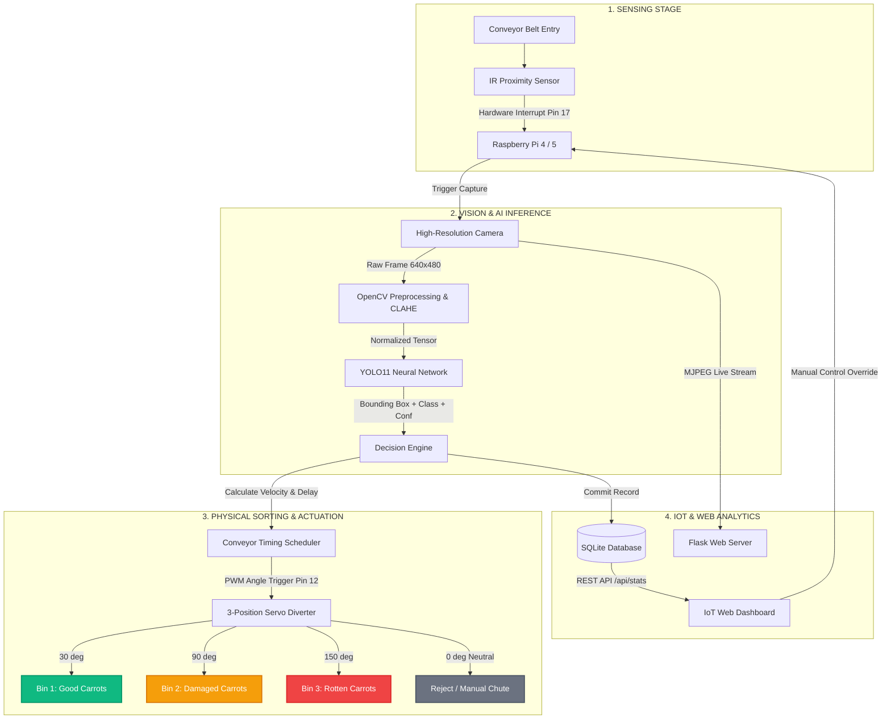
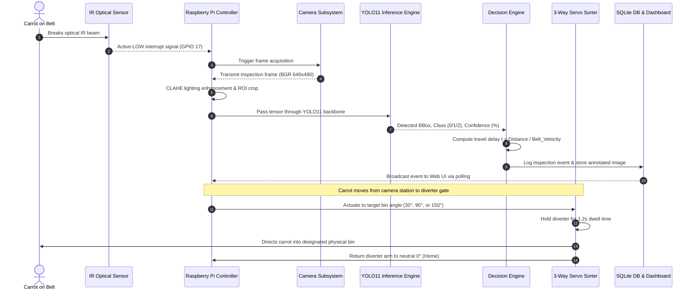

# System Architecture Specification
## Automated Carrot Quality Detection and Sorting System Using Deep Learning, Computer Vision and IoT
**Academic Master of Engineering (M.E.) Project**

---

## 1. Executive Architecture Overview

The system operates as an autonomous, closed-loop cyber-physical sorting machine. It integrates high-speed computer vision, deep convolutional feature extraction (YOLO11), real-time embedded hardware control (Raspberry Pi GPIO), and an industrial IoT web monitoring dashboard.

---

## 2. Sequence of Operations (Closed-Loop Automation)

---

## 3. Mathematical Formulations & Mechanical Timing

### 3.1 Conveyor Belt Linear Velocity
The linear velocity of the conveyor belt $v$ is determined by the DC motor rotational speed and the conveyor drive pulley radius $R_p$:

$$v = \omega \cdot R_p = \left( \frac{2\pi \cdot N}{60} \right) \cdot R_p$$

Where:
- $N$ = Effective motor rotational speed (RPM) under load, modulated by PWM duty cycle $D$:
  $$N(D) = N_{\text{max}} \cdot \left(\frac{D}{100}\right)$$
- $R_p$ = Drive pulley radius ($0.025\text{ m} = 25\text{ mm}$)
- $v_{\text{max}}$ = Nominal maximum velocity at $D=100\%$ ($0.20\text{ m/s}$)

### 3.2 Time-of-Flight (Travel Delay)
The time interval $t_{\text{delay}}$ required for a carrot to travel from the camera optical inspection centerline to the physical sorting diverter gate located at distance $L$ is:

$$t_{\text{delay}} = \frac{L}{v} = \frac{L}{v_{\text{max}} \cdot \left(\frac{D}{100}\right)}$$

For a physical separation of $L = 0.35\text{ m}$ (35 cm) and operating duty cycle $D = 70\%$:
$$v = 0.20 \cdot 0.70 = 0.14\text{ m/s}$$
$$t_{\text{delay}} = \frac{0.35\text{ m}}{0.14\text{ m/s}} = 2.50\text{ seconds}$$

The Raspberry Pi scheduler starts a non-blocking asynchronous timer for $t_{\text{delay}}$ before driving the servo diverter.

### 3.3 50Hz PWM Duty Cycle Formula for Servos
Standard analog and digital hobby/industrial servos (TowerPro SG90, MG995, MG996R) operate with a $50\text{ Hz}$ frame frequency ($T = 20\text{ ms}$ period). The control pulse width $W_p$ varies between $0.5\text{ ms}$ ($0^\circ$) and $2.5\text{ ms}$ ($180^\circ$):

$$\text{Duty Cycle } (\%) = \left( \frac{W_p}{T} \right) \cdot 100 = \left( \frac{0.5\text{ ms} + \frac{\theta}{180^\circ} \cdot 2.0\text{ ms}}{20\text{ ms}} \right) \cdot 100$$

$$\text{Duty Cycle } (\%) = 2.5 + \left(\frac{\theta}{180}\right) \cdot 10.0$$

| Destination Position | Target Angle ($\theta$) | Pulse Width ($W_p$) | PWM Duty Cycle (\%) |
| :--- | :---: | :---: | :---: |
| **Neutral / Reject Tray** | $0^\circ$ | $0.50\text{ ms}$ | $2.50\%$ |
| **Bin 1 (Good Carrots)** | $30^\circ$ | $0.83\text{ ms}$ | $4.17\%$ |
| **Bin 2 (Damaged Carrots)** | $90^\circ$ | $1.50\text{ ms}$ | $7.50\%$ |
| **Bin 3 (Rotten Carrots)** | $150^\circ$ | $2.17\text{ ms}$ | $10.83\%$ |

---

## 4. Software Architecture Layers

1. **Hardware Abstraction Layer (`hardware/`)**:
   Provides uniform device control. Uses hardware `RPi.GPIO` when on Raspberry Pi OS; seamlessly falls back to `MockPWM` and virtual interrupts when running on development PCs.
2. **Vision & Preprocessing Layer (`camera/`)**:
   Captures frames via `cv2.VideoCapture` or synthetic animated conveyor generator; applies CLAHE (Contrast Limited Adaptive Histogram Equalization) on Lightness channel to remove conveyor belt shadows.
3. **Deep Learning Inference Layer (`training/predict.py`)**:
   Loads Ultralytics YOLO11 model, performs multi-scale inference, extracts bounding box tensors and class probabilities.
4. **Decision & Routing Engine (`sorting/decision_engine.py`)**:
   Applies confidence thresholding ($C_{\text{min}} = 0.50$). If $C < C_{\text{min}}$, directs object to Reject Chute. Otherwise, maps class $0 \to \text{Bin }1$, class $1 \to \text{Bin }2$, class $2 \to \text{Bin }3$.
5. **Persistence & Analytics Layer (`backend/database.py`)**:
   SQLite engine storing inspection history, classification counts, and time-stamped images.
6. **Presentation & IoT Layer (`backend/app.py` & `web_dashboard/`)**:
   Flask-powered REST API, MJPEG video feed, responsive Bootstrap 5 interface, and Chart.js telemetry graphs.
